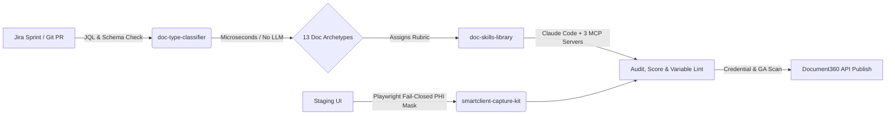

# Justin S. Severn
**Senior Technical Writer & DocOps Engineer | Healthcare IT, AI Agent Tooling & Deterministic Documentation Systems**

Portfolio & 14 Enterprise Samples: [justinsevern.com](https://justinsevern.com)  
LinkedIn: [linkedin.com/in/justinsevern](https://www.linkedin.com/in/justinsevern)  
Location: St. Petersburg, FL (Open to Remote Staff/Senior DocOps, Technical Writing & AI Knowledge Roles)

---

### What I Build
Critical enterprise documentation rots faster than human teams can maintain it by hand—and in regulated healthcare software (HIPAA, Medicaid, HL7 FHIR, ANSI X12), stale docs or leaked PHI in screenshots cause real operational and compliance failures.

I build **deterministic documentation tooling** paired with **bounded AI agent workflows** (Claude Code skills + Model Context Protocol servers) to govern a 1,900+ article healthcare knowledge base:

### Flagship Open-Source DocOps Tooling

| Repository | Stack | Purpose |
| :--- | :--- | :--- |
| **[doc-skills-library](https://github.com/pinklightultra/doc-skills-library)** | Markdown / Claude Code / MCP | 21 public, sanitized Claude Code agent skills (from 61 internal production skills) for auditing a 1,900-article corpus, scoring drafts, and linting system variables. |
| **[smartclient-capture-kit](https://github.com/pinklightultra/smartclient-capture-kit)** | JavaScript / Playwright | Automated UI screenshot capture for enterprise SmartClient apps with **fail-closed DOM/canvas redaction** so patient PHI or customer PII never ships in an image. |
| **[doc-type-classifier](https://github.com/pinklightultra/doc-type-classifier)** | Python (Zero-Dependency) | Classifies documentation into 13 structural archetypes from raw HTML in microseconds—no LLM calls, no network latency, 100% explainable decisions. |

### Production Impact (MHK, 2024-Present)
- **Release Notes Automation:** Cut biweekly Jira-to-HTML release notes effort from **1 full workday (8 hrs) to 2 hours** across 10+ consecutive on-time releases.
- **Corpus Throughput:** Scaled annual knowledge base maintenance from **88 edits/year to ~1,000 edits/year**, authoring **779 new articles in 2026**.
- **Support Deflection:** Classified **17,500 support tickets** to map avoidable customer contacts to documentation gaps, saving **875+ support hours/year**.